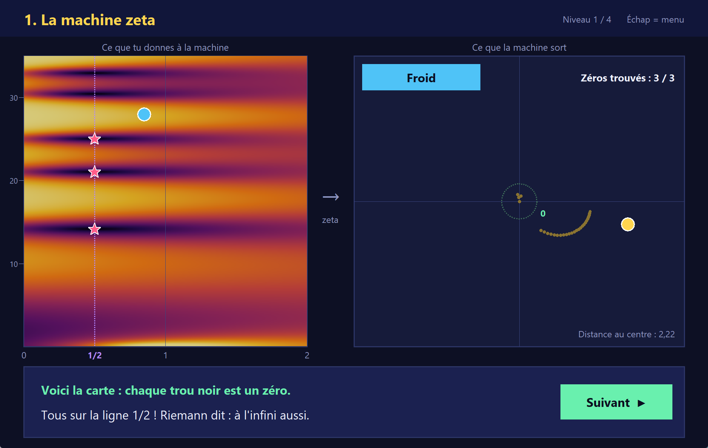
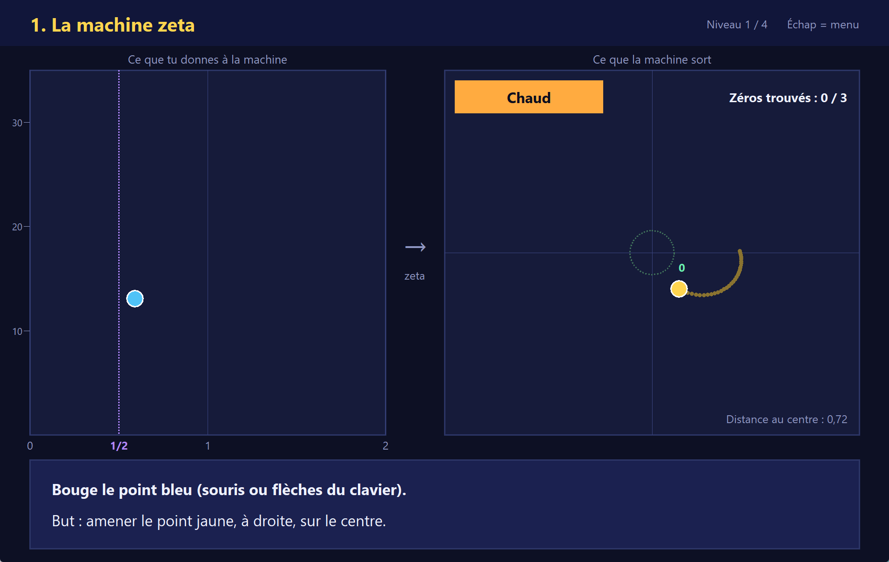
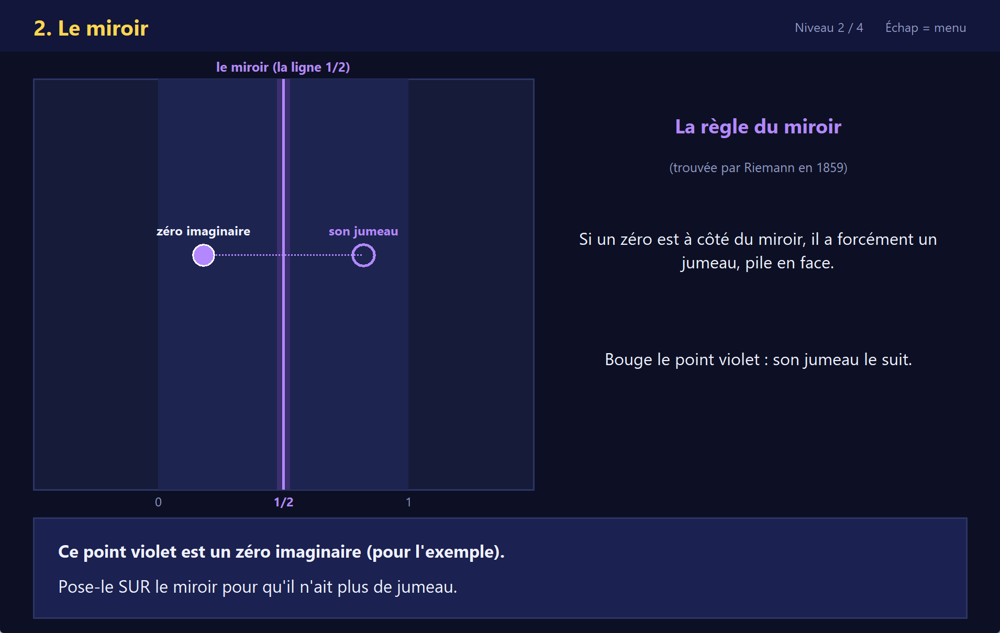
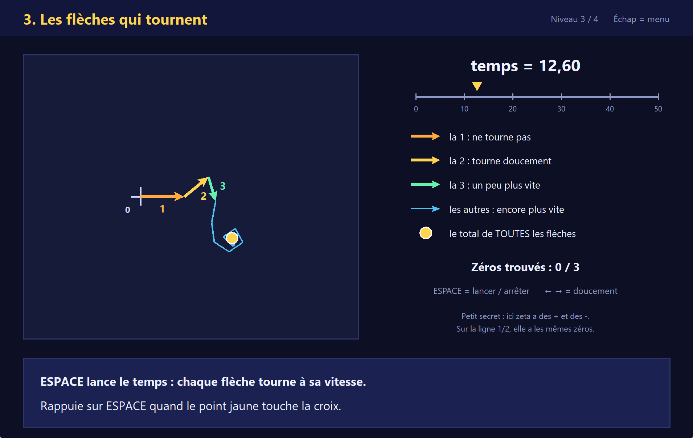
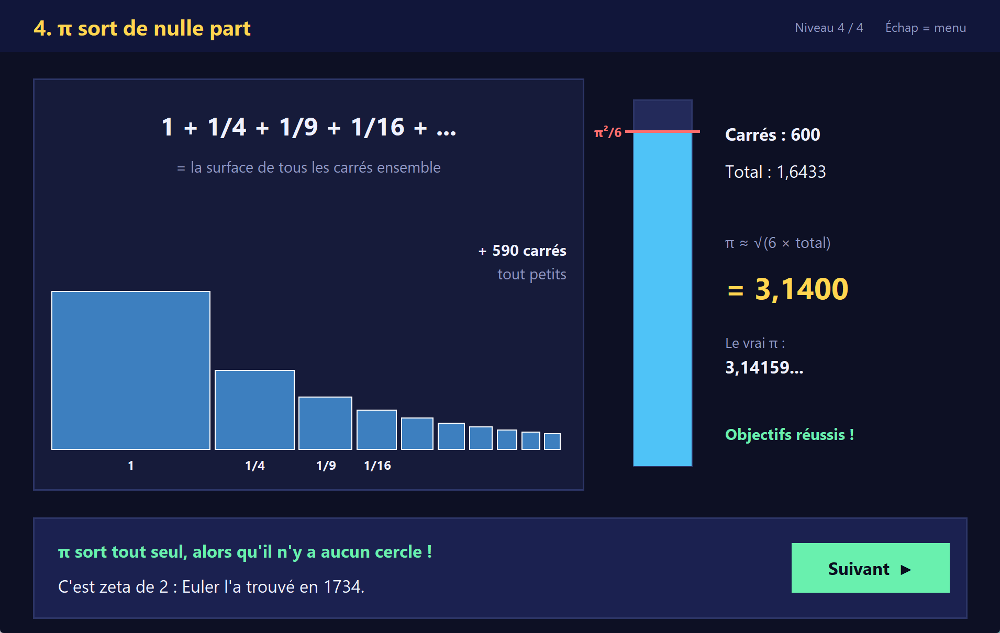

<div align="center">

# La chasse aux zéros de Riemann

**Un petit jeu en Python pour *voir* l'hypothèse de Riemann, sans formule compliquée.**

*A small Python game to **see** the Riemann hypothesis (game in French). [English below](#english).*

[](https://github.com/SNOWDIABLO/riemann-zero-hunt/actions/workflows/tests.yml)

[](LICENSE)



</div>

## Pourquoi ce jeu ?

L'hypothèse de Riemann est l'un des plus grands problèmes ouverts des maths (1 million de dollars à la clé). Elle dit que tous les zéros "intéressants" de la fonction zeta sont posés sur une seule ligne, la ligne 1/2.

En août 2026, Anthropic a annoncé qu'une version de recherche de **Claude** (son IA) avait trouvé une preuve, vérifiée par des mathématiciens : **au moins 67 %** de ces zéros sont bien sur la ligne. L'ancien record était d'environ 41 %. Ça ne prouve pas l'hypothèse entière, mais c'est un énorme pas.

Ce jeu sert à comprendre de quoi on parle, **en jouant, un pas à la fois**. Pas besoin d'être bon en maths.

## Les 4 niveaux

### 1. La machine zeta
Tu bouges un point à gauche, la machine zeta sort un point à droite. Ton but : amener le point de droite pile sur le centre. Un thermomètre te dit si tu chauffes. Après 3 zéros trouvés, la carte complète apparaît : tous les trous noirs sont sur la même ligne.



### 2. Le miroir
Riemann a découvert en 1859 que zeta a un miroir. Un zéro posé à côté de la ligne aurait forcément un jumeau, pile en face. Tu poses un zéro imaginaire sur le miroir pour qu'il devienne son propre reflet, puis tu vois ce qui est prouvé aujourd'hui.



### 3. Les flèches qui tournent
Zeta, c'est une somme de petites flèches. Quand le "temps" avance, chaque flèche tourne à sa propre vitesse. Un zéro, c'est le moment précis où toutes les flèches s'annulent et où le total tombe pile au centre. À toi d'arrêter le temps au bon moment.



### 4. π sort de nulle part
1 + 1/4 + 1/9 + 1/16 + ... = π²/6. Tu ajoutes des carrés un par un et tu regardes π apparaître, alors qu'il n'y a aucun cercle. C'est zeta de 2, trouvé par Euler en 1734.



## Lancer le jeu

**Windows (le plus simple)**
1. Installe [Python](https://www.python.org/downloads/).
2. Télécharge ce dépôt (bouton vert **Code**, puis **Download ZIP**) et décompresse-le.
3. Double-clic sur **`Lancer le jeu.bat`**. La première fois, il installe numpy tout seul.

**Linux (Debian, Ubuntu)**
```bash
sudo apt install python3-tk python3-numpy git
git clone https://github.com/SNOWDIABLO/riemann-zero-hunt.git
cd riemann-zero-hunt
python3 riemann_jeu.py
```

**Mac (avec Homebrew)**
```bash
brew install python python-tk git
git clone https://github.com/SNOWDIABLO/riemann-zero-hunt.git
cd riemann-zero-hunt
python3 -m venv .venv
source .venv/bin/activate
pip install -r requirements.txt
python riemann_jeu.py
```
Le jeu est testé sur Windows 11. Il devrait marcher sur Mac et Linux, mais ce n'est pas encore vérifié.

## Contrôles

| Touche | Action |
|---|---|
| Souris | bouger les points, cliquer sur les boutons |
| Flèches du clavier | bouger doucement |
| ESPACE | lancer / arrêter le temps (niveau 3), ajouter un carré (niveau 4) |
| Entrée | niveau suivant quand c'est gagné |
| Échap | revenir au menu |

## Les maths sont vraies

Le jeu ne triche pas : tout est calculé pour de vrai.

- **Zeta** est calculée avec l'algorithme de Borwein (sur la fonction eta), et à gauche de la ligne 1/2 avec l'équation fonctionnelle de Riemann (le fameux miroir).
- **`tests/test_maths.py`** compare le jeu à une deuxième méthode totalement différente (Euler-Maclaurin) sur 3000 points : écart maximum d'environ 0,000000000002. Il vérifie aussi les 10 premiers zéros, ζ(2) = π²/6, ζ(-1) = -1/12, que la capture d'un zéro ne se trompe jamais et que le thermomètre ne ment pas.
- **Ce qui est simplifié, et dit clairement dans le jeu :**
  - niveau 2 : le point violet est un zéro *imaginaire*, juste pour montrer la règle du miroir ;
  - niveau 3 : on utilise eta (zeta avec des + et des -), qui a exactement les mêmes zéros sur la ligne 1/2 ;
  - niveau 1 : la carte va de 0 à 2. Les zéros "faciles" (en -2, -4, ...), dont l'hypothèse ne parle pas, sont volontairement hors de l'écran.

Lancer les tests :
```bash
python tests/test_maths.py     # les maths
python tests/captures.py       # ouvre le jeu, teste chaque niveau, refait les captures (Windows)
```

## Sources

- Y. Lamzouri, [*A new proof that more than 2/3 of the zeros of the Riemann zeta function are simple and on the critical line*](https://arxiv.org/abs/2609.02882), arXiv:2609.02882 (2026). Le résumé explique que la première preuve a été produite par une version de recherche interne de Claude, puis vérifiée par deux mathématiciens.
- DataCamp, [*Claude Tried the Riemann Hypothesis. Here's What Happened.*](https://www.datacamp.com/tutorial/claude-and-the-riemann-hypothesis) (août 2026).
- Neowin, [*Unreleased Claude model makes breakthrough on century-old Riemann hypothesis math problem*](https://www.neowin.net/news/unreleased-claude-model-makes-breakthrough-on-century-old-riemann-hypothesis-math-problem/).

## English

**Riemann Zero Hunt** is a small, beginner-friendly Python game (tkinter + numpy, text in French) that lets you *see* the ideas behind the Riemann hypothesis in four short levels:

1. **The zeta machine**: move a point, watch what ζ outputs, and hunt three zeros. Then the full map shows every zero sitting on the line 1/2.
2. **The mirror**: the functional equation makes zeros come in mirror pairs around the line 1/2.
3. **Spinning arrows**: ζ as a sum of arrows each rotating at its own speed; a zero is the moment they all cancel out.
4. **π out of nowhere**: 1 + 1/4 + 1/9 + ... = π²/6 (Euler, 1734).

Everything is computed for real (Borwein's algorithm + the functional equation), and checked against an independent Euler-Maclaurin implementation in `tests/test_maths.py`.

The game was inspired by the result Anthropic announced in August 2026: more than two thirds of the zeros lie on the critical line. The proof was first produced by an internal research version of Claude, then verified by two mathematicians ([arXiv:2609.02882](https://arxiv.org/abs/2609.02882)).

Run it: `pip install -r requirements.txt` then `python riemann_jeu.py` (see the install steps above for Linux and Mac).

License: [PolyForm Strict 1.0.0](LICENSE). You may view the code and play for free, for any noncommercial purpose. You may not sell it, change it, or share copies or modified versions. Ask first for anything else.

## Soutenir le projet / Support

Fait par **SnowDiablo**, streamer et créateur. Si le jeu t'a plu :

- ⭐ mets une étoile au dépôt, ça aide vraiment ;
- soutiens-moi sur [Patreon](https://www.patreon.com/c/snowdiablo) ;
- passe dire bonjour en live sur [Twitch](https://www.twitch.tv/snowdiablo) ou sur le [Discord](https://discord.gg/cNPwNdaVN9).

Idées, bugs, envie d'un niveau 5 ? Ouvre une [issue](https://github.com/SNOWDIABLO/riemann-zero-hunt/issues).

## Licence

© 2026 SnowDiablo. Le jeu est sous licence **[PolyForm Strict 1.0.0](LICENSE)**.

En clair (ce résumé n'a pas de valeur juridique, seul le texte de la licence compte) :
- ✅ tu peux télécharger le jeu, y jouer et lire le code, gratuitement, pour toi, à l'école ou pour tout usage non commercial ;
- ❌ interdit de le vendre ou de s'en servir pour gagner de l'argent ;
- ❌ interdit de le modifier, d'en faire une autre version, ou d'en partager une copie (partage plutôt le lien de ce dépôt).

Pour tout autre usage, demande l'autorisation : ouvre une [issue](https://github.com/SNOWDIABLO/riemann-zero-hunt/issues) ou passe sur le [Discord](https://discord.gg/cNPwNdaVN9).

Code écrit avec l'aide de Claude Code.
